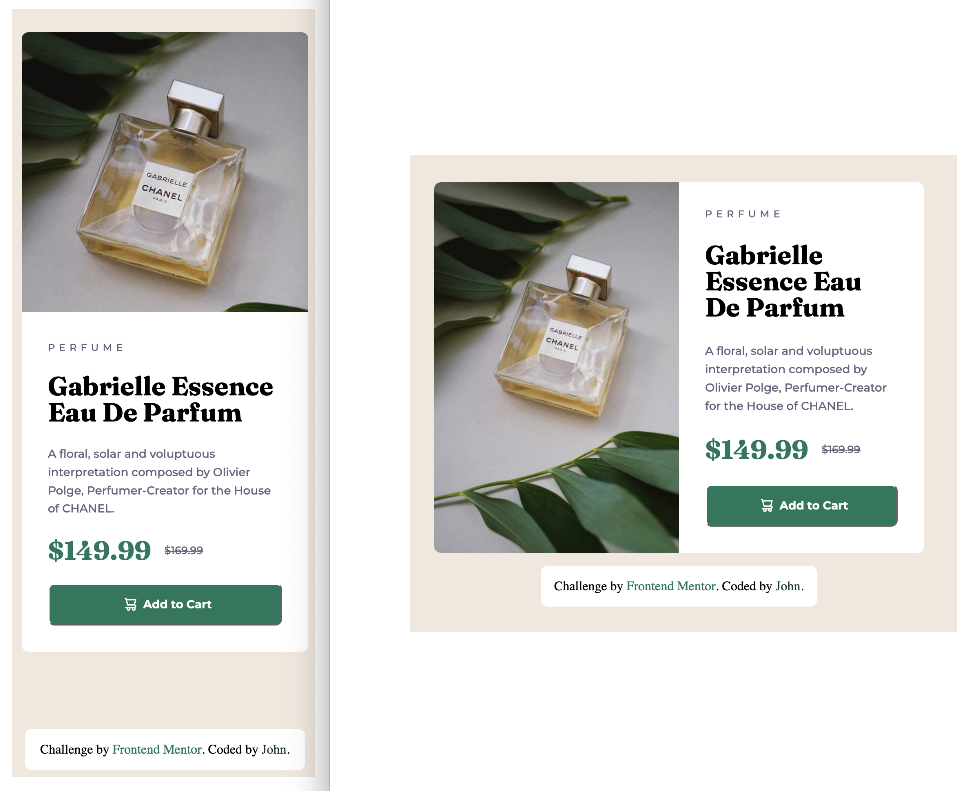

# Frontend Mentor - Product preview card component solution

This is a solution to the [Product preview card component challenge on Frontend Mentor](https://www.frontendmentor.io/challenges/product-preview-card-component-GO7UmttRfa). Frontend Mentor challenges help you improve your coding skills by building realistic projects. 

## Table of contents

- [Overview](#overview)
  - [The challenge](#the-challenge)
  - [Screenshot](#screenshot)
  - [Links](#links)
- [My process](#my-process)
  - [Built with](#built-with)
  - [What I learned](#what-i-learned)
  - [Useful resources](#useful-resources)
- [Author](#author)

## Overview

### The challenge

Users should be able to:

- View the optimal layout depending on their device's screen size
- See hover and focus states for interactive elements

### Screenshot

### Links

- Solution URL: [Solution URL here](https://github.com/RoomForEpsilon/product-preview-card-component)
- Live Site URL: [Live site URL here](https://roomforepsilon.github.io/product-preview-card-component/)

## My process

Upon initially seeing the Figma file, I thought, "Another card.  More of the same."  However, changing the direction of the card from column to row was not a trivial thing to style.  I'm glad that Frontend Mentor takes small steps forward, because I was able to handle the new challenge without being overwhelmed.  Since this section is supposed to be about my process, let's get to that.

First, I styled the page for mobile.  I've done this before, so that was easy.  Next I attempted to style the page for tablet.  After I put the media query in and changed the flex-direction from column to row, the card visually broke.  I read a bunch of articles, but none of them helped.  Eventually, I asked ChatGPT to link me to an article that covered the problem that I was facing without telling me the answer, and it linked to an MDN article about the object-fit property.  That fixed part of the card.  I was also reminded that width percentage calculations are based on the width of the parent -- not the width of the browser (which I'm sure I was told several times, but didn't matter to me until this project) -- and adding a width to the card's containing element helped as well.  After that, everything fell into place.  Those were my memorable challenges.  

### Built with

- Semantic HTML5 markup
- CSS custom properties
- Flexbox
- Mobile-first workflow

### What I learned

This will reiterate what I said in the My Process section.  I learned that percentage widths are calculated based upon the width of the parent element, not the entire browser window.  I also learned a little more about how images are displayed.

### Useful resources

- [Optimize Cumulative Layout Shift](https://web.dev/articles/optimize-cls) - Helps to understand how to prevent cumulative layout shift.

- [Jank-free page loading with media aspect ratios](https://blog.logrocket.com/jank-free-page-loading-with-media-aspect-ratios/) - Another article on the topic of layout shifts.

- [CSS Gradients](https://css-tricks.com/css3-gradients/) - Taught me how to create the background stripes that turned out to be not part of the background, but design guides in the Figma file.

## Author

- Frontend Mentor - [@RoomForEpsilon](https://www.frontendmentor.io/profile/RoomForEpsilon)